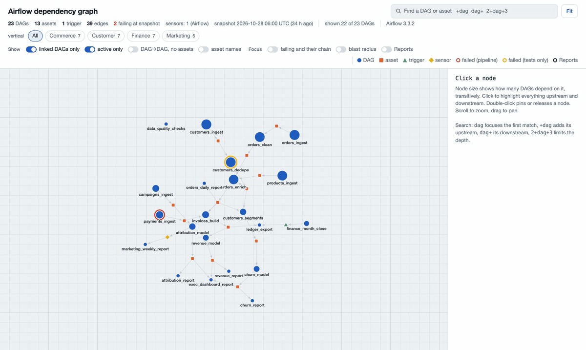
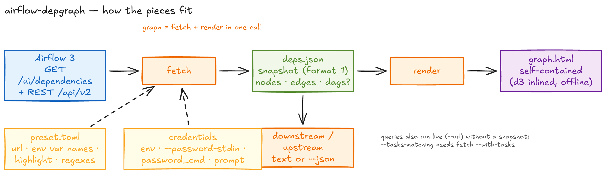
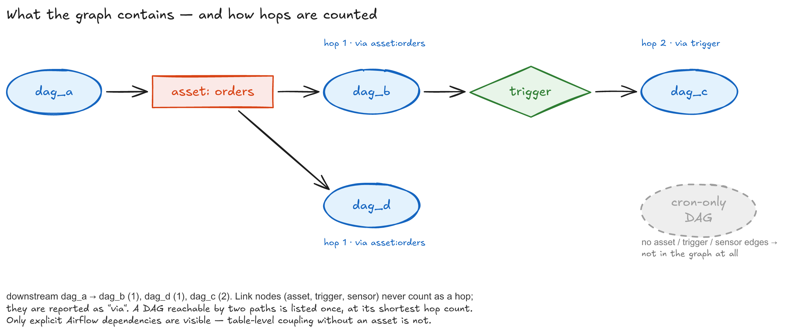
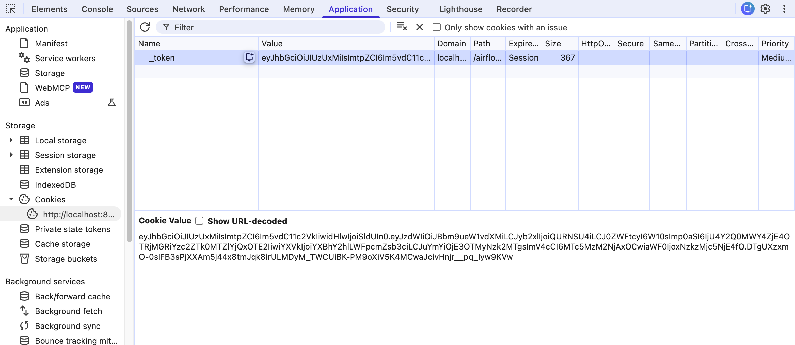
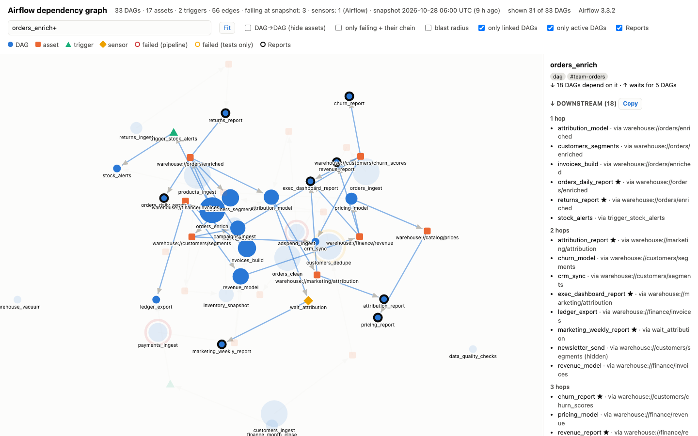
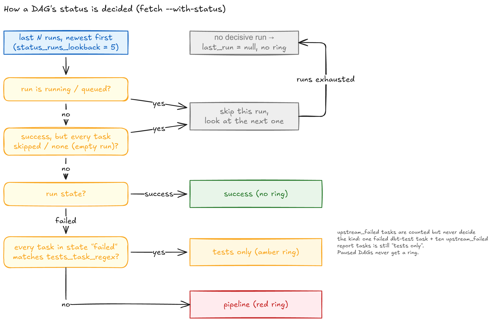

# airflow-depgraph


Fetch, query and render the Airflow 3 cross-DAG dependency graph (DAG → asset / trigger / sensor → DAG) from any Airflow 3 instance. It uses only the Python standard library. The result is a JSON snapshot you can query offline, plus one self-contained HTML page.





Things to know before you use it:

- **Airflow 3 only.** Airflow 2 has no `/ui/dependencies` endpoint, so it is not supported.
- **Internal endpoint.** `/ui/dependencies` belongs to the Airflow UI, not the public API. It may change between releases. For example, 3.1.8 started filtering it by DAG permissions. The tool was developed against Airflow 3.3.2.
- **Pure cron DAGs have no edges.** A DAG with no asset, trigger or sensor link is not part of `/ui/dependencies`. It is taken from the DAG catalog instead: the page lists it under *DAGs without dependencies*, and `report unlinked` prints it.

## What the graph contains



Only explicit Airflow dependencies are visible: asset events, `TriggerDagRunOperator` triggers and `ExternalTaskSensor`s. Other sensors that wait on a DAG can be added with `--infer-sensors` (see [Sensor dependencies (inferred)](#sensor-dependencies-inferred)). `downstream`/`upstream` count hops between DAGs; the asset, trigger or sensor that joins two DAGs is reported as `via`. A DAG reachable by several paths is listed once, at its shortest hop count. Table-level coupling without an asset is invisible here.

## Install

Python 3.11 or newer is required.

```bash
uv tool install git+https://github.com/fridayqq/airflow-depgraph
# or
pipx install git+https://github.com/fridayqq/airflow-depgraph
```

To run from a checkout, use `uv run airflow-depgraph ...`.

## Airflow plugin

The same package is also an Airflow 3 plugin. Installed into the Airflow image, it adds
**Browse → DAG Dependencies**: the graph page inside the Airflow UI, for the signed-in user.
Tested on Airflow 3.1.5 and 3.3.2, at the root and under a sub-path such as `/airflow/`.

- **Data.** The page calls the api-server's own `/ui/dependencies` and REST API with the
  user's session token. DAG-level permission filtering of the graph is done by Airflow itself
  from 3.1.8 on; earlier 3.1.x returns every DAG to any user who may read dependencies.
  Nothing else is stored.
- **Loopback URL.** The plugin reaches its own api-server at
  `http://127.0.0.1:<[api] port><base path>`. Set `AIRFLOW_DEPGRAPH_LOOPBACK_URL` when the
  api-server uses TLS, another port flag, or a non-loopback bind.
- **Sign-in.** Without a session (or with an expired one) the page redirects to the Airflow
  login and comes back afterwards.
- **Status rings.** Off by default because they cost one REST call per DAG. Open the page
  with `?status=1`, or set `AIRFLOW_DEPGRAPH_WITH_STATUS=true`. The rendered page is kept in
  memory per session token for five minutes (at most 64 pages); permission changes show up
  after that.
- **Load.** Each api-server process builds at most three pages at once; when more than six more are queued, the page answers 503 with `Retry-After: 30` instead of waiting.
- **Headers.** Every response carries a `Content-Security-Policy`, `X-Content-Type-Options: nosniff` and `Referrer-Policy: same-origin`.
- **Inferred sensor links.** Off by default. With `AIRFLOW_DEPGRAPH_INFER_SENSORS=true` a
  background refresh adds them; see [Sensor dependencies (inferred)](#sensor-dependencies-inferred).
- **Settings.** None are needed: the page finds the facet chips on its own and shows every
  DAG the user may see. To tune it, set the same `AIRFLOW_DEPGRAPH_*` variables as the CLI on
  the api-server: `..._TAG_FACET` (pin the chip family, e.g. `vertical:`), `..._TAGS`
  (comma-separated, the *only tags* filter), `..._HIGHLIGHT` and `..._HIGHLIGHT_LABEL`,
  `..._ASSET_LABEL_STRIP_PREFIX`, `..._TITLE`, `..._TESTS_TASK_REGEX`. A preset named in
  `AIRFLOW_DEPGRAPH_PRESET` works too, if its file is inside the image.

**Install on Astro.** Add one line to the project's `requirements.txt` and rebuild:

```text
airflow-depgraph @ https://github.com/fridayqq/airflow-depgraph/archive/refs/tags/v0.7.0.tar.gz
```

```bash
astro dev restart      # local / self-hosted Astro project
# or: astro deploy     # Astro cloud
```

The archive URL needs no git in the image (Astro runtime images have none).

**Install on other Airflow 3 images.** `pip install` the same URL into the image that runs
the api-server (for example in your Dockerfile), then restart the api-server. Only the
api-server needs it; installing it everywhere is harmless. The plugin is found through the
`airflow.plugins` entry point, so nothing goes into the `plugins/` folder.

**Check.** `airflow plugins` lists `airflow_depgraph`, and the menu shows the new item.

**Behind a reverse proxy.** Set `[api] base_url` (`AIRFLOW__API__BASE_URL`) to the absolute public URL,
including the sub-path, e.g. `https://host.example.com/airflow`. The menu link and the "Open in Airflow" links are built from it.

## Claude Code skill

The repo also ships a [Claude Code](https://claude.com/claude-code) skill,
`skills/airflow-depgraph/SKILL.md`. With it, Claude uses this CLI end to end when you ask
things like "which DAGs depend on `orders_load`?" or "draw the dependency graph of my
Airflow": it checks the CLI is installed, picks or helps you create a preset, fetches the
snapshot, answers in text and renders and opens the page. It keeps passwords out of commands
and chat (environment variable, `--password-stdin` or `password_cmd`).

The skill calls the CLI, so install the CLI first (see [Install](#install)). Then install the
skill in one of three ways.

**As a plugin (recommended, gets updates):**

```text
/plugin marketplace add fridayqq/airflow-depgraph
/plugin install airflow-depgraph@airflow-depgraph
```

From a shell: `claude plugin marketplace add fridayqq/airflow-depgraph`, then
`claude plugin install airflow-depgraph@airflow-depgraph`. Plugin skills are namespaced, so
the explicit command is `/airflow-depgraph:airflow-depgraph`; Claude also picks it up on its
own when a request matches.

**As a personal skill (all your projects):**

```bash
mkdir -p ~/.claude/skills/airflow-depgraph
curl -fsSL https://raw.githubusercontent.com/fridayqq/airflow-depgraph/main/skills/airflow-depgraph/SKILL.md \
  -o ~/.claude/skills/airflow-depgraph/SKILL.md
```

**As a project skill (shared with a team through git):** copy the same file to
`.claude/skills/airflow-depgraph/SKILL.md` in that project. Personal and project skills are
invoked as `/airflow-depgraph`.

**Setup once per Airflow instance.** Create a preset so Claude does not have to ask for the
URL each time:

```bash
airflow-depgraph init                    # asks a few questions, writes ~/.config/airflow-depgraph/presets/prod.toml
# export the user and password variables it names, then check the result:
airflow-depgraph presets --preset prod
```

To write the file by hand instead, start from `airflow-depgraph presets --example` (see [Presets](#presets)).

Then ask Claude, for example: "use the prod preset and show me everything downstream of
`orders_load`, then open the graph".

## Quick start

New to this? Run `airflow-depgraph init` first: it creates a preset for your Airflow by asking questions (see [Create a preset](#create-a-preset)).

```bash
export AIRFLOW_DEPGRAPH_URL=https://airflow.example.com
export AIRFLOW_DEPGRAPH_USER=alice
export AIRFLOW_DEPGRAPH_PASSWORD=...

# Save a snapshot, then render it to a page
airflow-depgraph fetch -o deps.json
airflow-depgraph render deps.json -o graph.html

# Or both in one go: writes graph.html and graph.json
airflow-depgraph graph -o graph.html

# Open the page in the browser (macOS; xdg-open on Linux, start on Windows)
open graph.html

# Which DAGs run downstream of my_dag?
airflow-depgraph downstream my_dag deps.json

# Only those that have a task matching a regex (snapshot needs --with-tasks)
airflow-depgraph fetch --with-tasks -o deps.json
airflow-depgraph downstream my_dag --tasks-matching 'refresh|report' deps.json
# Or use the preset's task_query_regex instead of a regex on the command line
airflow-depgraph downstream my_dag --tasks-preset deps.json
```

`upstream` works the same way. Each row shows the hop, the DAG, the link it came through (`via`), the DAG it was reached from and, with status in the snapshot, the last decisive run; `--tree` prints the result as an indented tree instead. `--depth N` must be at least 1. `tasks <dag> [snapshot]` lists the tasks of a DAG. If you omit the snapshot argument, `downstream`, `upstream` and `tasks` query the live instance. `--depth N` limits the traversal and `--json` prints machine-readable output.

Other options worth knowing:

- `--status FILE` (on `render` and `graph`) overrides the status of DAGs from a JSON file `{dag_id: {kind, paused, date}}`.
- `--node-id dag:my_dag` (on `fetch` and `graph`) fetches only the subgraph around one node.
- `--title` sets the page title and `--highlight REGEX` highlights DAG ids that match.
- `--tag NAME` (on `fetch`, `render` and `graph`, repeatable) sets the page's default tag filter. It replaces the `tags` of the preset or the environment.
- `presets --preset NAME` prints the resolved settings of a preset (never the token).
- `--infer-sensors` (on `fetch` and `graph`) adds DAG dependencies found in Python and custom sensors. `--no-inferred` and `--include-guards` (on `downstream` and `upstream`) control how they are followed.

## Credentials

The password is never accepted as a flag, so it stays out of shell history and process lists. It is read from the first of these that applies:

1. `--password-stdin`, which reads one line from stdin.
2. The environment variable named by `password_env`, `AIRFLOW_DEPGRAPH_PASSWORD` by default.
3. The command in `password_cmd` (`init` writes `password_env = ""` when the command is the only source, so the variable lookup is skipped), for example `pass show airflow/example`, taking its stdout.
4. An interactive prompt, when stdin is a terminal.

The user comes from `--user` or the variable named by `user_env` (`AIRFLOW_DEPGRAPH_USER` by default). A preset can only change the variable name through `user_env`, never hold the user itself. A bearer token takes precedence over all of the above and skips the login: `--token-stdin` reads it from the first line of stdin; `--token` does the same from the command line, with a warning, since it is visible in shell history and `ps`. `AIRFLOW_DEPGRAPH_TOKEN` works too. The two flags cannot be combined. The token is the JWT Airflow keeps in the browser's `_token` cookie after login (DevTools, Application or Storage, Cookies), or the `access_token` returned by `POST /auth/token` with a JSON body `{"username": …, "password": …}`. It expires after `[api_auth] jwt_expiration_time`, a day by default; after that every call gets a 401 and exit code 2.


### Get a token from the browser

The quickest way to use the tool, and the only one when you log in to Airflow through SSO and have no API password. The token is the JWT that Airflow keeps in a cookie after you log in.



1. Log in to Airflow in your browser as usual.
2. Open DevTools: F12, or ⌥⌘I on a Mac.
3. Open the *Application* tab (Firefox and Safari: *Storage*), expand *Cookies* on the left and click your Airflow origin.
4. Click the row named `_token`. The full value appears in the *Cookie Value* box; copy it from there (the value in the table is cut off).
5. Give it to the tool, and nothing else is needed:

```bash
export AIRFLOW_DEPGRAPH_TOKEN='eyJ…'
airflow-depgraph graph --url https://airflow.example.com --with-status --infer-sensors -o graph.html
```

Or keep it out of the environment: `pbpaste | airflow-depgraph fetch --url https://airflow.example.com --token-stdin -o deps.json` on a Mac, `xclip -o | …` on Linux.

The token expires after the time the Airflow admin set, a day by default, and the cookie is gone when you close the browser; log in again and copy a fresh one. When a token stops working the tool says so and points back here.

### Without credentials

The tool needs nothing beyond what the Airflow UI already shows you. If you would rather not hand it a password, save the graph from a logged-in browser tab and work offline:

1. Open `https://airflow.example.com/ui/dependencies` in the browser where you are logged in to Airflow. Airflow 3 answers with the JSON its own dependencies view uses.
2. Save it as a file, for example `deps.json`.
3. Pass that file to any command that takes a snapshot:

```bash
airflow-depgraph render deps.json -o graph.html
airflow-depgraph downstream my_dag deps.json
airflow-depgraph report critical deps.json
```

Such a file holds only the nodes and edges, so the page shows the linked DAGs without status rings, the tag and paused filters and inferred sensor links. `fetch` adds those with the DAG catalog, `--with-status` and `--infer-sensors`.
## Exit codes

| Code | Meaning |
|---|---|
| 0 | Success |
| 1 | Any other error, for example a bad snapshot or preset |
| 2 | Usage error (bad or conflicting arguments) |
| 3 | Credentials: no username or password, rejected login, or 401/403 from Airflow |
| 4 | Airflow unreachable: no response, timeout or DNS failure |
| 5 | DAG not in the dependency graph |
| 130 | Interrupted |

## Create a preset

`airflow-depgraph init [NAME]` writes `NAME.toml` by asking questions in the terminal. Every answer is checked against your Airflow, which also proposes tags, an asset prefix to strip (every prefix shared by at least two assets, cut at a separator, most assets first) and the optional settings. Sensor inference is recommended when the task lists of a sample of 40 active DAGs contain at least one sensor other than `ExternalTaskSensor` and the time, file and BI sensors. Nothing is written until you confirm at the end, and the password is never asked for as a stored value: you name an environment variable or a command that prints it.

```text
$ airflow-depgraph init
airflow-depgraph init — new preset
Ctrl-C to quit, nothing is written until the end.

[1/7] Name
Preset name [prod]:

[2/7] Airflow URL
Airflow URL, e.g. https://airflow.example.com: https://airflow.example.com
✓ Airflow is reachable (scheduler healthy)

[3/7] User
Environment variable that holds the user name [AIRFLOW_DEPGRAPH_USER]:
not set in this shell

[4/7] Password source
  1) environment variable
  2) command (pass, Keychain, 1Password…)
Where does the password come from? [1]:
Environment variable that holds the password [AIRFLOW_DEPGRAPH_PASSWORD]:
not set in this shell

[5/7] Sign-in check
No password variable or command is available: you will be asked once; it is used for this check only and discarded.
User name (for this check only, not stored): alice
Airflow password:
✓ signed in as alice — Airflow 3.3.2

[6/7] Choices
✓ 584 DAGs (431 active, 153 paused), 210 assets, 12 sensor nodes, 7 sensor tasks in 40 sampled DAGs
Tags (the page shows only DAGs with these tags):
  1) team-a  (116)
  2) team-b  (74)
Numbers and/or names, comma-separated, - for none [-]: 1
...

[7/7] Advanced
Change advanced settings? [y/N]:

This is the file that will be written (/home/alice/.config/airflow-depgraph/presets/prod.toml):
...
Write it? [Y/n]:
✓ wrote ~/.config/airflow-depgraph/presets/prod.toml

Next:
  export AIRFLOW_DEPGRAPH_USER=…
  export AIRFLOW_DEPGRAPH_PASSWORD=…
  airflow-depgraph presets --preset prod
  airflow-depgraph graph --preset prod -o graph.html
```

If the sign-in fails you can retry, skip the checks (the questions then come without suggestions) or quit. Ctrl-C or Ctrl-D at any point stops with exit code 130 and writes nothing; quitting at the sign-in prompt or answering n to the final "Write it?" prints "not written" and exits 1. With a password command, init writes `password_env = ""`, so the sign-in check and every later run use the command and never an environment variable. An existing preset is only replaced after you confirm, or with `--force`. The file goes to `--dir`, else `$AIRFLOW_DEPGRAPH_PRESETS`, else `~/.config/airflow-depgraph/presets`.

**Without a terminal.** `--yes` asks nothing and takes every value from flags; a missing NAME or `--url` is a usage error (exit 2). `--discover` takes none of `--yes`, NAME, `--force`, `--no-check`, `--tag` or `--dir`. The sign-in check still runs unless you pass `--no-check`, and a failure writes nothing (exit 3 for credentials, 4 for an unreachable Airflow). Credentials come from the usual places (`--password-stdin`, the password variable, `password_cmd`); `--user` is used for the check only and never written.

```bash
airflow-depgraph init prod --yes --url https://airflow.example.com \
  --tag team-a --strip-prefix 's3://bucket/' --with-status \
  --user-env MY_AIRFLOW_USER --password-cmd 'pass show airflow/prod'
```

Flags: `--user-env`, `--password-env`, `--password-cmd`, `--tag` (repeatable), `--strip-prefix`, `--highlight`, `--highlight-label`, `--title`, `--with-status`/`--no-status`, `--infer-sensors`/`--no-infer-sensors`, `--tests-task-regex`, `--task-query-regex`, `--lookback`, `--timeout`, `--workers`. Without `--yes` they answer the matching question, which is then not asked.

**Discovery.** `--discover` reads from Airflow and writes nothing; with `--json` the output is meant for scripts and for the Claude Code skill, which builds its menus from it:

```bash
airflow-depgraph init --discover --json --url https://airflow.example.com
```

```json
{"url": "https://airflow.example.com", "airflow_version": "3.3.2", "scheduler": "healthy",
 "dags": {"total": 584, "active": 431, "paused": 153},
 "tags": [{"name": "team-a", "dags": 116}],
 "assets": 210, "asset_prefixes": [{"prefix": "s3://bucket/", "assets": 40}],
 "sensor_nodes": 12,
 "sensor_tasks": {"sampled_dags": 40, "candidates": 7},
 "suggest": {"with_status": true, "infer_sensors": true}}
```

`tags` lists every tag by DAG count. `dags` counts the DAGs that are not stale. `sensor_tasks` counts the candidate sensor tasks in the task lists of a sample of active DAGs (`sampled_dags` is how many could be read); `suggest.infer_sensors` is true when there is at least one.

## Presets

A preset is a TOML file of defaults for one Airflow instance. Credentials are never stored in it, only the names of environment variables or a command.

Settings are resolved in this order, first match wins: command-line flag, environment variable `AIRFLOW_DEPGRAPH_<KEY>` (for example `AIRFLOW_DEPGRAPH_URL`, `AIRFLOW_DEPGRAPH_WITH_STATUS`), preset file, built-in default.

A preset name is looked up in these directories, in order:

1. `$AIRFLOW_DEPGRAPH_PRESETS`
2. `$XDG_CONFIG_HOME/airflow-depgraph/presets`, which is `~/.config/airflow-depgraph/presets` by default
3. the presets bundled with the package

`--preset` also accepts a path to a `.toml` file. `--preset none` ignores any preset, including one set through `AIRFLOW_DEPGRAPH_PRESET`. `airflow-depgraph presets` lists what is found.

```bash
airflow-depgraph init prod       # or write it by hand:
mkdir -p ~/.config/airflow-depgraph/presets
airflow-depgraph presets --example > ~/.config/airflow-depgraph/presets/prod.toml
# edit prod.toml, then:
airflow-depgraph graph --preset prod -o graph.html
```

The example preset:

```toml
# Preset name, shown in the output.
name = "example"
# Base URL of the Airflow webserver.
# url = "https://airflow.example.com"
# Name of the env var that holds the Airflow user name.
# user_env = "AIRFLOW_USER"
# Name of the env var that holds the Airflow password.
# password_env = "AIRFLOW_PASSWORD"
# Shell command that prints the password to stdout (used when the env var is empty).
# password_cmd = "pass show airflow/example"
# Also fetch the latest run status of every DAG.
# with_status = false
# Also fetch the tasks of every DAG.
# with_tasks = false
# Title of the rendered page.
# title = "Airflow dependency graph"
# Prefix removed from asset names when they are shown as labels.
# asset_label_strip_prefix = "s3://example-bucket/"
# Regex matched against DAG ids (without the dag: prefix); matching DAG nodes are highlighted.
# Assets, triggers and sensors are never highlighted.
# highlight = "^example_"
# Legend label for the highlighted nodes.
# highlight_label = "Highlight"
# Tag prefix shown as chips on the page: with "vertical:" a tag vertical:Sales makes a Sales chip.
# tag_facet = "vertical:"
# Regex that marks a task as a test task (case-insensitive).
# tests_task_regex = '(^|[._-])tests?([._-]|$)'
# Regex used by --tasks-preset. Nothing is filtered at load time; all tasks are fetched.
# task_query_regex = "^(extract|load)_"
# How many recent runs to look at when computing the status.
# status_runs_lookback = 5
# Default page filter: only DAGs with any of these tags (the page can switch it off).
# tags = ["team-a"]
```

`tags` is a TOML list of strings. In the environment it is comma-separated: `AIRFLOW_DEPGRAPH_TAGS="team-a,analytics"`.

**Timeout, workers and retries.** `timeout` (seconds per API request, default 25) and `workers` (parallel requests for run status, task lists and sensor inference, default 8) are preset keys too, set as `AIRFLOW_DEPGRAPH_TIMEOUT` and `AIRFLOW_DEPGRAPH_WORKERS`, or with `--timeout` and `--workers` on fetch, graph, downstream, upstream, tasks and report. Requests keep one connection open per thread, and a response of 429, 502, 503 or 504, or a timeout or connection error, is retried up to twice, after 1 s and then 3 s (a numeric `Retry-After` header is honoured, capped at 30 s). Other 4xx errors are never retried, and the login request is retried at most once. Set `HTTP_PROXY` or `HTTPS_PROXY` and each request goes through urllib instead, without the connection reuse.

**Run status.** Status comes from bulk listings of runs and task instances by default, with the same result as reading each DAG; `--no-bulk-status` or `bulk_status = false` reads each DAG instead.

## Page features

The page is a single HTML file with d3 inlined, so it works offline.



- **Layout.** Node size grows with the number of transitive downstream DAGs. The shape shows the node type: DAG, asset, trigger or sensor.
- **Status.** With `--with-status`, a red ring marks a pipeline failure and an amber ring marks a failure that is tests only. Paused failing DAGs get no ring. A DAG with no decisive run in the lookback has no status. Dark mode follows the system setting.
- **Click.** Selecting a node highlights its upstream and downstream chain. The side panel lists both directions grouped by hop, each row with the link it came through, and a *Copy* button copies a list as plain text. Double-click pins or releases a node.
- **Fit.** The view zooms to the shown nodes after loading and after a filter change; the *Fit* button does it on demand. Labels stay the same size on screen: the focused nodes are always labelled, the rest appear as you zoom in.
- **Blast radius.** With *blast radius* on and nothing selected, the side panel lists the failing DAGs that pass the filters, the ones with the most downstream DAGs first.
- **Header.** The number of DAGs shown out of the total, and the snapshot age.
- **Search.** Type a DAG name to focus it. `+dag` adds everything upstream, `dag+` everything downstream, and `2+dag+3` limits that to 2 levels up and 3 down.
- **Facet chips.** When the DAG tags carry a family such as `vertical:Sales`, `vertical:Finance`, the header shows one chip per value with its DAG count. Chips combine: a DAG lights up when it carries any of the chosen values, the rest of the graph dims but stays, so links between verticals remain visible. With nothing selected the side panel sums up the choice: DAGs on screen, failures, and which other values they are linked to. The family comes from `tag_facet` in the preset (`--tag-facet`, `AIRFLOW_DEPGRAPH_TAG_FACET`); unset, the page takes the prefix up to the first `:` that has at least two values and the most DAGs. Needs the DAG catalog.
- **Toggles.** Hide assets, name the assets, triggers and sensors of the focused chain (*asset names*, off by default; the selected node is always named), show only failing DAGs, and highlight the DAGs matched by the preset `highlight` regex. On a phone the toggles and filters fold into a *Filters* button.
- **Filters.** Three filters are on by default. *only linked DAGs* hides DAGs that have no asset, trigger or sensor link to another DAG; switched off, those DAGs appear in a grid below the graph and in a searchable *DAGs without dependencies* list in the side panel. *only active DAGs* hides paused DAGs. *only tags: …* keeps the DAGs that carry any of the configured `tags`; it is shown only when tags are configured. *+ linked DAGs of other teams* (off by default) also keeps DAGs of other tags that are one edge or one asset, trigger or sensor away from a kept DAG. Assets, triggers and sensors stay only while they still join kept nodes. *only failing* applies after these filters. The header shows how many DAGs are on screen out of the total. These filters need the DAG catalog (see the snapshot format); stale DAGs are never shown.
- **Hash flags.** The page writes its state to the URL fragment as you type or toggle, so a view can be shared: `#q=<text>,onlyFail,hideAssets,names,hl,allLinks,paused,allTags,conn,guards,blast,v=<facet values>,sel=<node id>`. Filters that are on by default appear as their negation: `allLinks` shows unlinked DAGs, `paused` shows paused DAGs, `allTags` switches the tag filter off, `conn` switches on *+ linked DAGs of other teams*, and `guards` shows inferred deploy guards. `blast` turns on blast radius, `names` switches *asset names* on, `v=Sales|Finance` chooses facet chips, and `sel=dag:my_dag` selects that node. The search text and node id are URL-encoded. Opening a page with such a fragment restores the view.

The text queries `downstream` and `upstream` are not filtered by tags or paused state.

## Sensor dependencies (inferred)

Airflow's `/ui/dependencies` only knows `ExternalTaskSensor`. Many DAGs wait on other DAGs with a
`PythonSensor`, a `@task.sensor` or a custom sensor, and those links are missing from the graph.
`fetch --infer-sensors` (also `graph`, or `infer_sensors = true` in a preset) looks for them.

- **What is checked.** Every task whose operator name contains "sensor", except
  `ExternalTaskSensor` (already in the graph) and sensors that wait on time, files or BI jobs:
  `TimeSensor`, `DateTimeSensor`, `TimeDeltaSensor`, `S3KeySensor`, `TableauJobStatusSensor`.
- **Three sources, first hit wins.**
  1. *Rendered fields* of the newest task instance with rendered fields among the last 5 runs.
     Every string equal to another DAG id is a target. Keys such as `external_task_id` or
     `task_ids` give the target tasks.
  2. *DAG source* (`GET /api/v2/dagSources/{dag_id}`), parsed with Python's `ast` and scoped to
     the sensor: the call with `task_id="<task>"`, the function its `python_callable` names, and
     the `@task.sensor` function of that name. String constants there that equal another DAG id
     are targets. If that finds nothing, or the file does not parse, the whole file's string
     literals count only when they name exactly one DAG. So a `TriggerDagRunOperator`, a
     `doc_md` mention or a DAG factory listing many ids does not become a sensor target.
  3. *Task log* of that task instance: a DAG id next to `dag_id=`, `dag:`, `DAG <id>`,
     `found for <id>` or `for DAG <id>`, for example `No successful DAG run found for
     orders_dag today.`, only when exactly one DAG matches.
  Only ids of DAGs that exist (in the catalog) count, and never the sensor's own DAG. A target
  the sensor's DAG already feeds directly (for example its own trigger target) is dropped.
  A sensor whose lookups failed is recorded with source `error`, one where nothing matched with
  `none`. A DAG whose task list cannot be read (for example a 403 because this user may not read
  it) is one `error` entry with task `*`. Only a 401 aborts the run.
- **Data wait or deploy guard.** A sensor whose rendered `op_kwargs.states` is exactly
  `["running"]` waits for the other DAG *not* to run. It is a deploy guard, not a data
  dependency; guards are only detected from rendered fields. Guards are drawn dashed and grey,
  hidden until *show deploy guards* is on (hash flag `guards`), and `downstream`/`upstream`
  follow them only with `--include-guards`. Every other match is a data dependency.
- **On the page.** An inferred link is a dashed sensor node between the two DAGs, with dashed
  edges. Its side panel says where it was found. The tag, active and linked filters treat it like
  any other sensor. The header shows `sensor links: N`.
- **In the text queries.** `via` reads `sensor:<task> (inferred)`. `--no-inferred` ignores all
  inferred links. Live queries (no snapshot argument) infer too when `infer_sensors` is on in
  the preset or environment. `--node-id` skips both the catalog and the inference.
- **Cost.** One task list per DAG, then about 3 to 8 API calls per sensor: the recent runs, one
  to five task instances, the DAG source (once per DAG) and at most one log. About a minute on
  ~600 DAGs.
- **Limits.** Matching is by DAG id text. A DAG id built at runtime, or a sensor that has never
  run and does not name its target literally, is not found. A sensor that names several DAGs in
  its own code links to all of them.

**In the Airflow plugin.** The page never infers while you wait. Set
`AIRFLOW_DEPGRAPH_INFER_SENSORS=true` on the api-server, and a background thread starts after
the first page that Airflow served for a signed-in user. It refreshes every
`AIRFLOW_DEPGRAPH_INFER_INTERVAL_MINUTES` (default 30) and has its own concurrency slot, so it
never takes one of the page builds.

- **Token.** A refresh uses the session token of the most recent visitor, and only a token that
  Airflow has just accepted for a page, with at least 15 minutes left. Tokens stay in memory in
  the process that received them and are never logged or written to disk. After Airflow rejects
  the token (a 401, or a 403 on the first call) the refresh stops, keeps the previous links, and runs again as soon as the
  next visitor arrives. A 403 on a single DAG does not stop the refresh: that DAG counts as an
  error (see below), since from 3.1.8 on it only means this user may not read that DAG.
- **Failed refreshes.** A refresh that is aborted (401, or 401/403 from the first `GET
  /api/v2/dags`), or in which more than 20 % of the entries are errors, keeps the previous links.
  An aborted one runs again with the next accepted visitor, any other after a few minutes.
- **Several api-server workers.** One process per host and Airflow instance refreshes: the one
  holding an `flock` on `airflow-depgraph-infer-<hash>.lock`. It writes the links to
  `airflow-depgraph-inferred-<hash>.json`, and every worker serves the newest content of that
  file. `<hash>` is derived from the api-server URL, and the file also records that URL, so two
  Airflow instances on one host never read each other's links. When the refreshing process
  exits, another worker takes over on its next check.
- **State dir.** By default `<system temp dir>/airflow-depgraph-<uid>`, created with mode 0700;
  `AIRFLOW_DEPGRAPH_STATE_DIR` sets another one. It must be a real directory (not a symlink)
  owned by the api-server user, with no group or other write bit; otherwise the plugin logs a
  warning and each process refreshes on its own. Files are opened without following symlinks,
  written atomically (mode 600) and only read when owned by the same user. Without `fcntl` (not
  POSIX) each process also refreshes on its own.
- **Narrower visitor.** The background refresh runs as a recent visitor, so its result depends
  on what that user may see. A refresh that sees fewer than 80 % of the DAGs of the previous one
  keeps the previous links (and logs both counts). For complete links, make sure a
  broadly-permitted account visits the page regularly.
- **Header.** `sensor links: N, updated HH:MM UTC`, or that the first refresh is still running.

The background calls run as the most recent visitor, and Airflow's audit log shows them as that
user. On Airflow before 3.1.8 every user sees every DAG anyway. From 3.1.8 on, each viewer still
only gets the DAGs of their own `/ui/dependencies` and DAG catalog, and inferred links that
touch any other DAG are dropped from their page. An inferred link does tell anyone who may see
both DAGs that one waits on the other, even if that viewer could not read the sensor's code.

## How failing is decided

Status needs `--with-status` (or `with_status = true`). For each DAG:



- Runs are examined newest first, up to `status_runs_lookback`.
- Runs that are still running or queued are skipped. So are successful runs in which every task was skipped.
- The first remaining run is the decisive one. If it succeeded, the DAG is healthy. If it failed, the DAG is failing.
- A failing DAG is of kind `tests` when every task in state `failed` matches `tests_task_regex`. Otherwise it is a pipeline failure. The regex is configurable because a pipeline task named like `load_test_data` would otherwise count as a test.
- Tasks in state `upstream_failed` do not count, because they only inherit a failure.

## Reports

`report` answers portfolio questions from a snapshot file, offline:

```bash
airflow-depgraph report critical graph.json --top 10   # DAGs with the most transitive downstream DAGs
airflow-depgraph report unlinked graph.json            # active catalog DAGs with no links
airflow-depgraph report unconsumed-assets graph.json   # assets that have a producer but no consumer
airflow-depgraph report failing graph.json             # last decisive run failed, not paused
```

`--tag NAME` (repeatable) keeps rows with those tags; the default is the preset's `tags`, and
`--all-tags` turns the filter off. `unlinked` needs a catalog and `failing` needs status in the
snapshot, so fetch with `--with-status` for the failing report. `--json` prints a list instead of a table.

A DAG linked only by a deploy guard counts as linked in `report unlinked`.

## Snapshot format

Snapshots are JSON, format 1:

```json
{
  "format": 1,
  "fetched_at": "2026-10-22T08:00:00Z",
  "source": "https://airflow.example.com",
  "airflow_version": "3.3.2",
  "nodes": [
    {"id": "dag:my_dag", "label": "my_dag", "type": "dag"},
    {"id": "asset:1", "label": "my_asset", "type": "asset"}
  ],
  "edges": [{"source_id": "dag:my_dag", "target_id": "asset:1"}],
  "dags": {
    "my_dag": {
      "is_paused": false,
      "schedule": "Asset",
      "owners": ["alice"],
      "last_run": {"state": "failed", "kind": "tests", "failed_tasks": ["dbt_test"]},
      "tasks": ["extract", "dbt_test"]
    }
  },
  "catalog": {
    "my_dag": {"tags": ["team-a"], "is_paused": false, "is_stale": false, "schedule": "Asset", "owners": ["alice"]},
    "lonely_dag": {"tags": [], "is_paused": true, "is_stale": false, "schedule": "0 5 * * *", "owners": ["bob"]}
  },
  "inferred": [
    {"dag": "lonely_dag", "task": "wait_for_my_dag", "operator": "PythonSensor", "source": "rendered",
     "targets": ["my_dag"], "target_tasks": ["load"], "kind": "data"}
  ]
}
```

`dags` is optional. `catalog` is optional too: `fetch`, `graph` and the Airflow plugin fill it from one paginated `GET /api/v2/dags`, and the page filters need it. Without it (older snapshots, or a user who may not list DAGs) the page shows only linked DAGs, takes paused state from `dags`, and hides the tag filter. Catalog DAGs that are not in the graph become unlinked DAG nodes, and stale DAGs are dropped from the page. `last_run` is present with `--with-status` and `tasks` with `--with-tasks`. `inferred` is present with `--infer-sensors`: one entry per checked sensor, `source` is `rendered`, `source`, `logs` or `none` (nothing found), `kind` is `data` or `guard`. The `last_run` object is abbreviated here. Edges whose endpoints are missing from `nodes` are dropped on load. A file with `nodes` and `edges` but no `format`, as saved from `/ui/dependencies` in the browser, loads as a format 1 snapshot with nothing else in it (see *Without credentials*).

## Development

```bash
uv run pytest                     # Python tests; the page's JS tests run from here too when node is installed
uvx ruff check src tests
node --test tests/js/*.test.mjs   # graph-core.js only (list the files: older node does not expand a directory)
```

`tests/contract/` runs against a live Airflow 3. `bash tests/contract/start_standalone.sh` starts `airflow standalone` with the DAGs in `tests/contract/dags`; then set `DEPGRAPH_CONTRACT_URL` plus `DEPGRAPH_CONTRACT_USER` and `DEPGRAPH_CONTRACT_PASSWORD` (or `DEPGRAPH_CONTRACT_TOKEN`) and run `uv run pytest tests/contract`. CI does the same nightly against the latest Airflow 3.

The README demo `docs/images/demo.gif` is recorded by `docs/record_demo.mjs` from the fictional snapshot of `docs/demo_snapshot.py`; the comment at the top of the script has the steps. The diagrams in this README are drawn with Excalidraw. Sources live in `docs/diagrams/*.excalidraw`; re-export the PNG/SVG files in `docs/images/` after editing them.

## License

MIT. d3 7.9.0 is vendored under its ISC license, see `src/airflow_depgraph/vendor/D3-LICENSE`.
